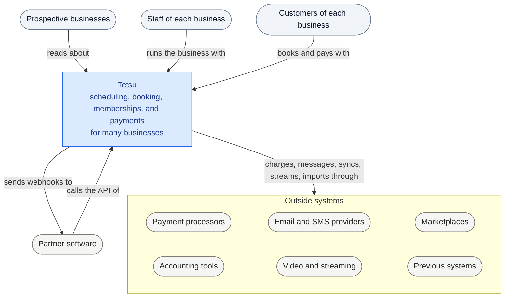
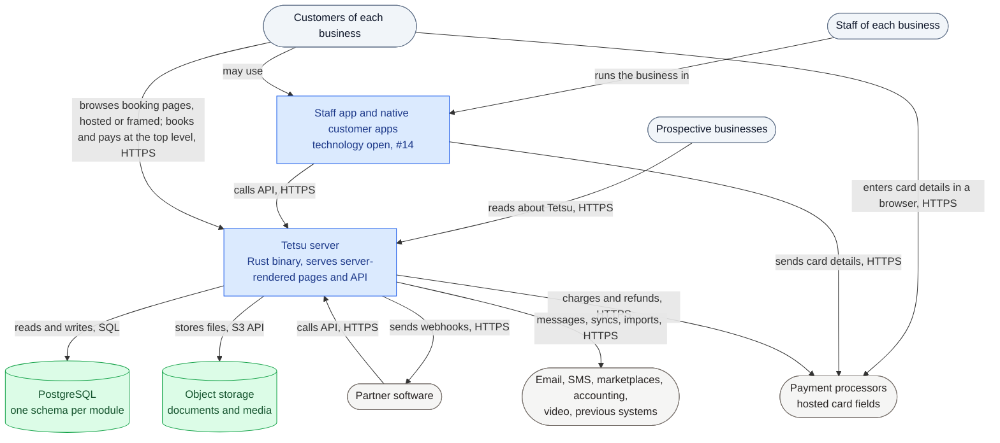
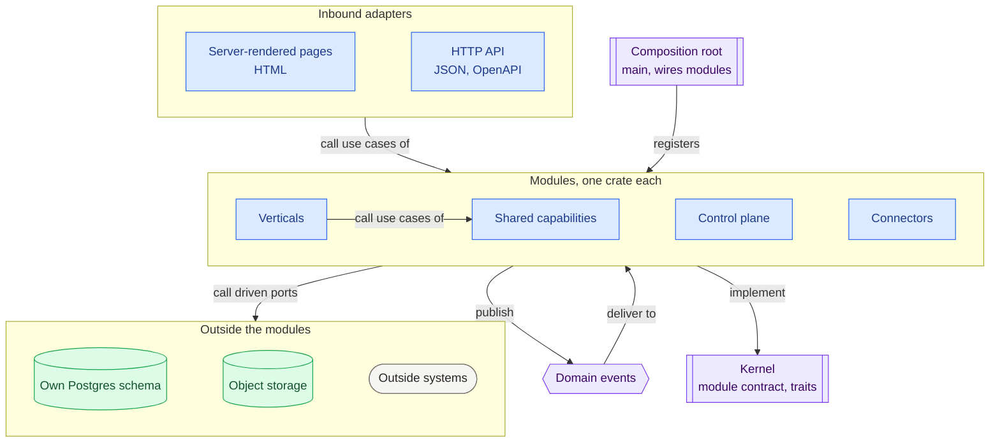
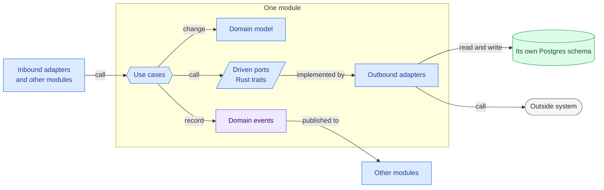
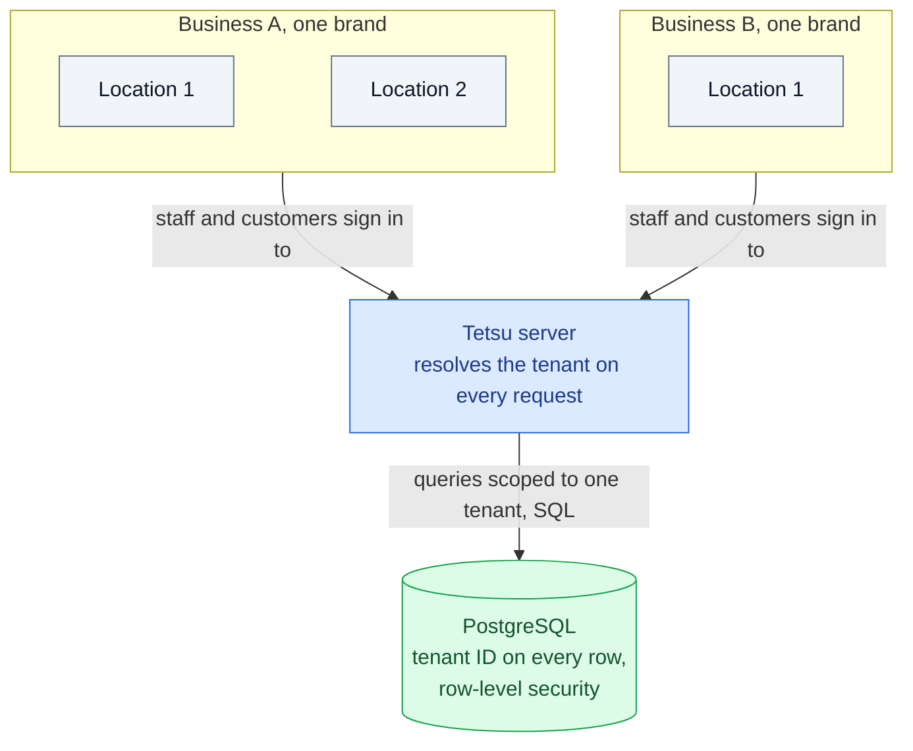
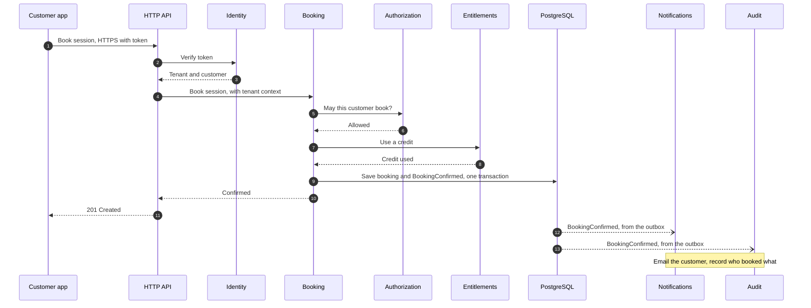
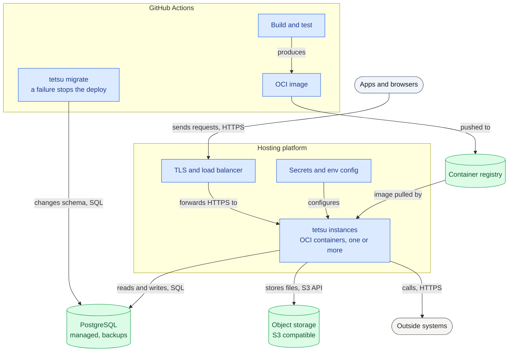

# Architecture

A bird's-eye view of Tetsu's design. The [README](README.md) describes what is implemented.
The [ADRs](docs/adr/README.md) hold the reasoning; this page holds the shape and
the rules that must stay true.

## Shape

Tetsu is a modular monolith built as a microkernel with hexagonal modules
([ADR-0003](docs/adr/0003-architecture.md)). It ships as one binary, `tetsu`,
which runs as the server, keeps records in PostgreSQL, and keeps files in
object storage. A small kernel defines the module contract, and the binary
wires the modules together.

[ADR-0002](docs/adr/0002-platform-and-verticals.md) decides what belongs in
the platform. The full capability map is in the
[Market Scan](docs/research/market-scan/platform-implications.md).

The diagrams follow the [C4 model](https://c4model.com/) and zoom in one level
at a time: system context, containers, components, and a single module, which
stands in for C4's code level. Views of tenancy, a request flow, and
deployment come last.

**Key.** Rounded gray boxes are people and their devices. Blue boxes are parts
of Tetsu, green cylinders are data stores, and purple marks the kernel,
composition root, and domain events. Rounded warm-gray boxes are outside
systems. Where it helps, a box adds its role or technology under its name.

### System context

Tetsu as one box: who uses it, and which outside systems it depends on. Many
businesses share one Tetsu, and each sees only its own data.

### Containers

Tetsu's separately running parts are blue and green. The server renders each
business's booking pages and a simple page about Tetsu, and serves the API.
PostgreSQL holds records, and object storage holds files such as signed
documents and media. Card details go from the browser or app
straight to the processor's hosted fields and never reach Tetsu
([ADR-0004](docs/adr/0004-security.md)).

Customers use the booking pages in a browser on Tetsu's address; a business's own domain
waits on [#8](https://github.com/heavymedl-labs/tetsu/issues/8). These are server-rendered
HTML with Web Component islands. A business can embed them in its own site as a frame for
browsing, and signing in and paying always happen at the top level
([ADR-0031](docs/adr/0031-front-end-model-revised.md)). The staff app, native customer apps, and
sites businesses build call the API. The staff app's technology is open
([#14](https://github.com/heavymedl-labs/tetsu/issues/14)), with WebAssembly the
intended choice. Every surface goes through the same use cases.

### Components

Inside the server. Inbound adapters call module use cases. Any module may call
another's use cases, except that the platform never calls a vertical. Modules
reach storage and outside systems through driven ports, talk through domain
events, and implement the kernel's contract. The composition root registers
every module. How a vertical changes platform behavior, such as a late-cancel
fee, is open ([#7](https://github.com/heavymedl-labs/tetsu/issues/7)): policy
ports the platform defines, verticals wrapping platform use cases, or
per-tenant configuration.

### Module

Every module has the same hexagonal shape: use cases in, driven ports out. Outside the module, its use cases
are reached only through a handle that its adapter constructors return, so no caller can skip them by calling a
port ([ADR-0021](docs/adr/0021-module-public-surface.md)).

### Tenancy

A tenant is one business: a brand and all its locations. Every request resolves
its tenant, and every query is scoped to it. Customer accounts belong to their
business ([ADR-0040](docs/adr/0040-identity-and-sign-in.md)). Tenants share
tables, with a tenant ID on every tenant-owned row, enforced by Postgres
row-level security ([ADR-0042](docs/adr/0042-tenant-isolation.md)).

### Request flow

Provisional: one booking, end to end. Sign-in, tenant isolation, and event
delivery follow [ADR-0040](docs/adr/0040-identity-and-sign-in.md),
[ADR-0042](docs/adr/0042-tenant-isolation.md), and
[ADR-0043](docs/adr/0043-domain-event-delivery.md).

### Deployment

The shape stays the same as we grow. The first environment runs on free tiers of Render
and Neon with fictional data, and moves to paid before a real business depends on Tetsu
([ADR-0012](docs/adr/0012-first-hosting-and-deploys.md)). The maintainer deploys a commit CI has checked, using
the image CI built ([ADR-0033](docs/adr/0033-deploys-on-demand.md)). Here "instances" are running
copies of the `tetsu` OCI image, not C4 containers.

## Quality goals

- Every surface, web or native, feels fast and intuitive. Performance budgets
  and an accessibility target come with the front-end decision
  ([#14](https://github.com/heavymedl-labs/tetsu/issues/14)).
- Identity, money, and tenant isolation get the highest testing rigor, and hot
  paths are benchmarked on every change
  ([ADR-0005](docs/adr/0005-testing-and-performance.md)).

## Known limits

What we expect to reach as Tetsu grows, most likely first. Nothing here is measured yet:
each is an estimate until a capacity run tests it
([ADR-0012](docs/adr/0012-first-hosting-and-deploys.md#benchmarking)).

| Limit | What happens | Planned response | Where it is decided |
| --- | --- | --- | --- |
| Outside services | Payment processors and SMS providers limit our rate during bursts such as waitlist messages or monthly renewals | Send through a queue with pacing and retries | [#11](https://github.com/heavymedl-labs/tetsu/issues/11) |
| Peaks at the same moment | Businesses share popular times, and bookings can open at a set moment, so load does not average out | Test with many simulated tenants, and consider staggering when bookings open | [ADR-0012](docs/adr/0012-first-hosting-and-deploys.md) and booking design |
| One tenant affecting others | Shared deployments mean a heavy report, a bad deploy, or a slow migration reaches every tenant | Per-tenant rate limits, timeouts, staged rollouts, and the option of separate [cells](docs/GLOSSARY.md) | [#8](https://github.com/heavymedl-labs/tetsu/issues/8) |
| Database connections | Instances times pool size reaches the host's limit, sooner if transactions hold connections longer | Pools that fail fast when full, no outside calls inside a transaction, and the app near Postgres | Pool limits in [ADR-0011](docs/adr/0011-server-stack-guardrails.md); the rest is not decided yet |
| Popular resources | Many customers compete for the same spots at once, so those requests slow down or fail | Concurrency tests and a tested locking choice | [ADR-0005](docs/adr/0005-testing-and-performance.md) and booking design |
| Postgres writes and growth | One primary takes all writes, and the ledger and audit log grow forever | Partition by time early, start indexes with tenant ID, and shard by tenant if ever needed | [#8](https://github.com/heavymedl-labs/tetsu/issues/8) |

## Invariants

The hard rules are in [docs/invariants.md](docs/invariants.md).
