# Studio evidence

What two real studios in Bellingham, Washington show their customers. Both run on Mariana Tek.
Captured 2026-11-04 from public pages and the maintainer's own customer accounts.
This is research, not a decision. Where it disagrees with an ADR, the
ADR wins. The conclusions are in [Customer channels](../customer-channels.md).

**How this was captured.** Read only: nothing was booked, bought, cancelled, or changed, and
both booking flows stopped before the final step. Staff tools, checkout, and check-in were not
seen. This is two studios on one vendor, so it shows what is possible, not what is typical.

**What the screenshots show.** They are not redacted, at the maintainer's request, so they include
instructor names and photos and the maintainer's own attendance, card endings, and order numbers.
Personal information pages are left out, because they hold a home address, phone number, and
birth date. These images show real people and other companies' products, so remove them if this
repository goes public.

## The setup

| | [Intent Hot Yoga](https://www.intenthotyoga.com) | [Ride Culture](https://www.rideculture.com) |
| --- | --- | --- |
| Website | Squarespace | Webflow, built by an agency |
| Booking | Mariana schedule, cart, and account embedded on the studio's own pages | The same |
| Branded app | [iOS](https://apps.apple.com/us/app/id6532580619), published as the studio, © Mariana Tek | [iOS](https://apps.apple.com/us/app/ride-culture/id1560258611) and [Android](https://play.google.com/store/apps/details?id=com.marianatek.rideculture), the same way |
| Earlier system | [Left Mindbody in July 2024](https://www.intenthotyoga.com/faqs). Members reset their password using the same email | Not known |

Embeds load from `<studio>.marianaiframes.com`, and the page's address tracks the step, as in
`?_mt=/classes/20533/reserve`.

## Schedule

A week strip with filters for instructor, class type, and room. Past classes are dimmed, and each
class shows the instructor, room, and next action.

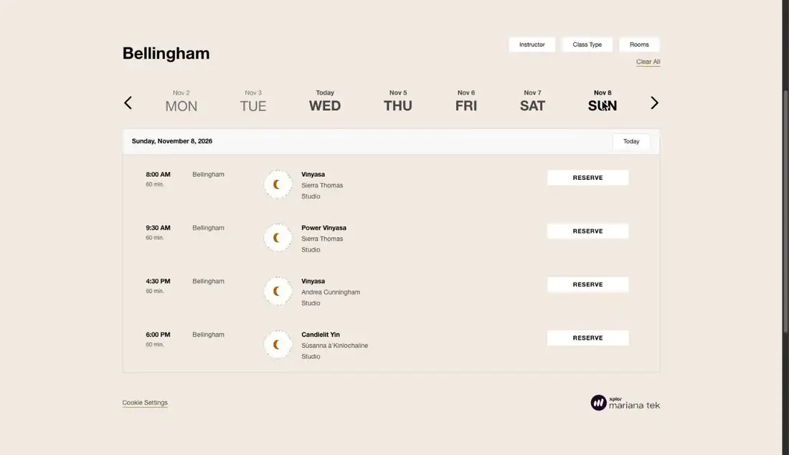

Full classes show "Waitlist Only" and a Join Waitlist button, days ahead on popular times.

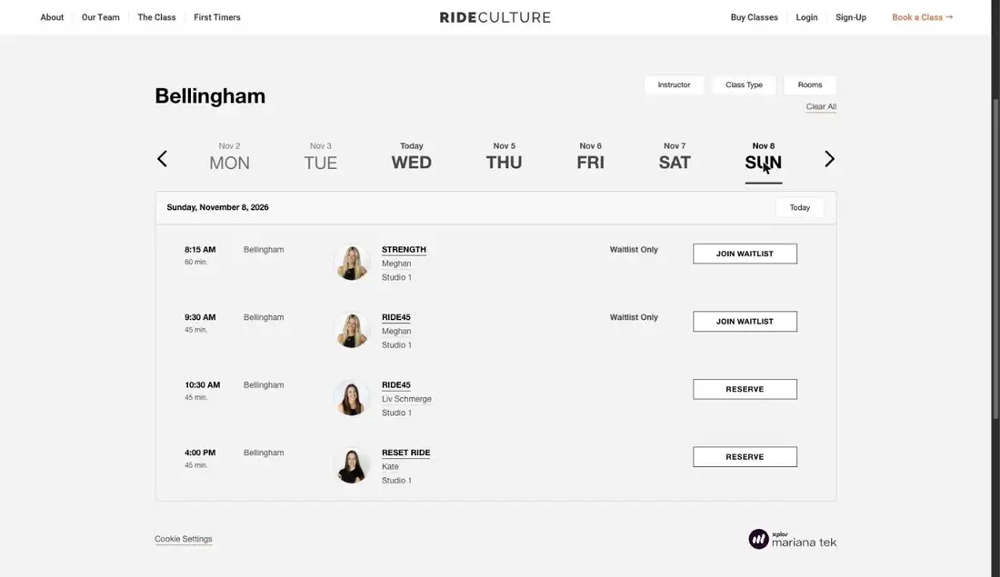

## Booking

Intent has a confirm step: reserve for yourself or a guest, and choose how to pay. Reservations
are required, and the [doors lock at start time](https://www.intenthotyoga.com/faqs).

Ride Culture adds a bike map: 33 numbered spots, with taken ones hatched.

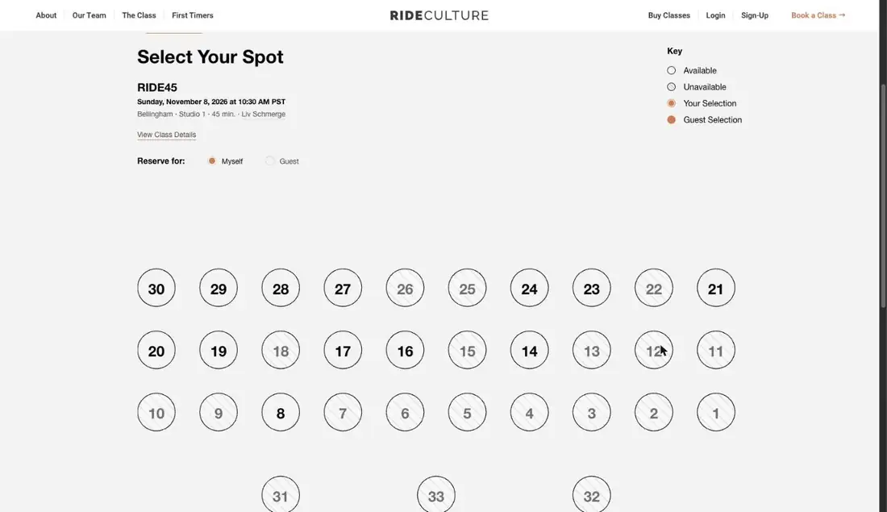

A customer with no membership or credit is offered "Buy and Reserve Class" after choosing a bike, so
buying happens inside the booking flow. This was as far as the flow went.

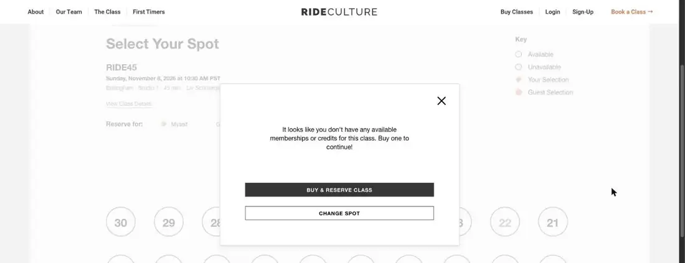

A reservation offers add to calendar, book a guest, and cancel.

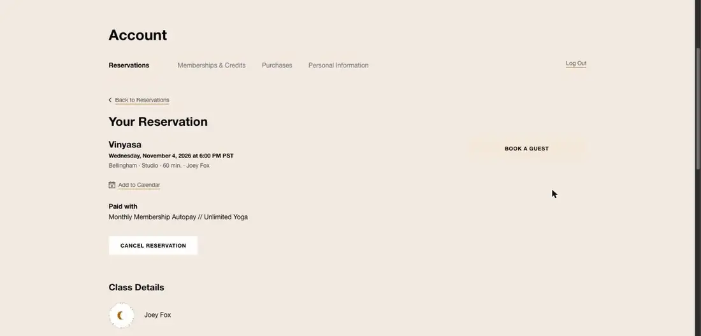

[Ride Culture's policies](https://www.rideculture.com/first-timers):

- **Late cancel:** under 8 hours loses a credit on a pack, or costs $25 plus tax on a membership.
  An account's history shows the result as "Penalty Cancel".
- **Waitlist:** email up to 12 hours before class. Inside 12 hours, staff text or call, and move
  on if they miss you.
- **Opening:** 4 and 8 pack memberships say class sign-up opens Sundays at noon.
- **Other:** no late arrivals, riders must be at least 13 and 4'11", and $2 shoe rental.

## Buying

Prices are on the studio's own pages, grouped into categories, with rules on each card.

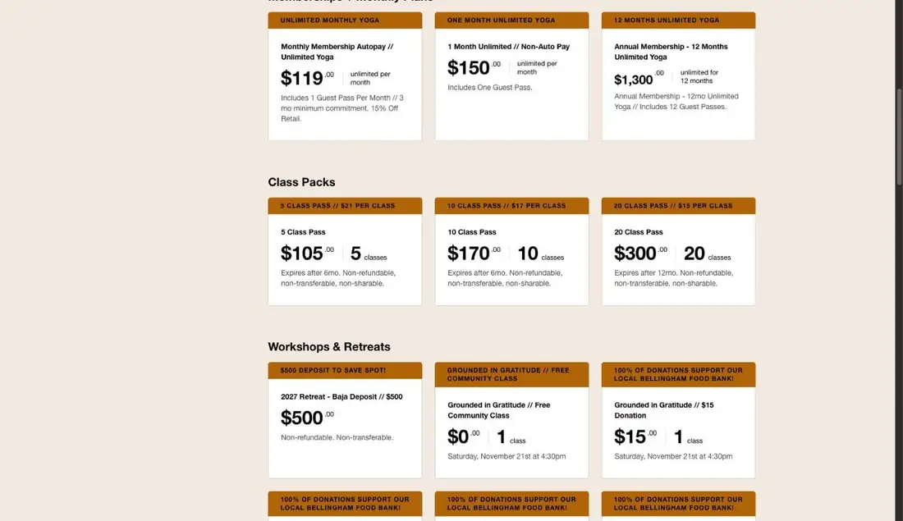

Products go beyond classes: retreat deposits, a community class at several donation levels, a guest
drop-in, and gift certificates.

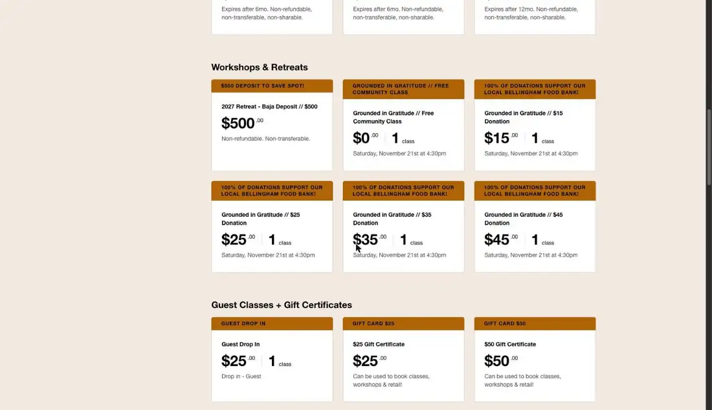

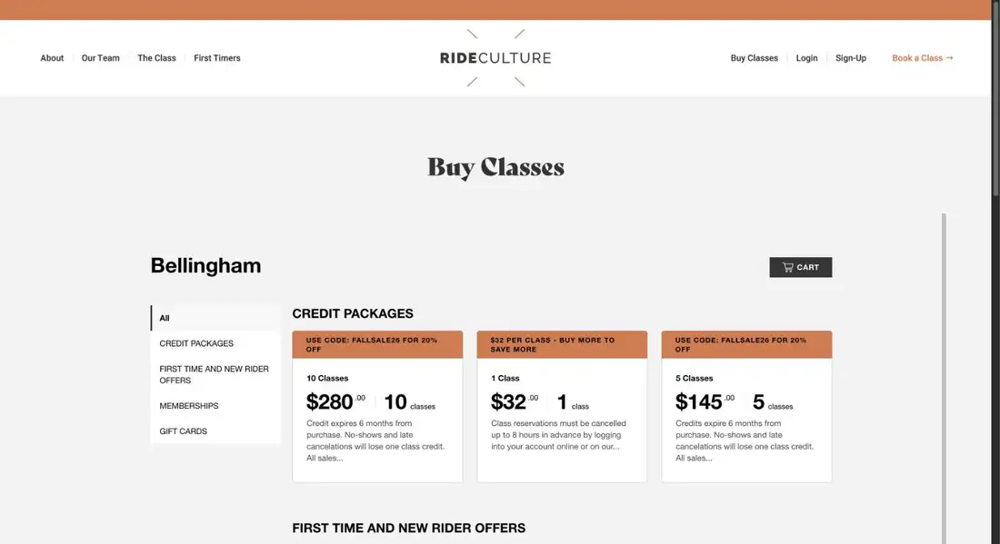

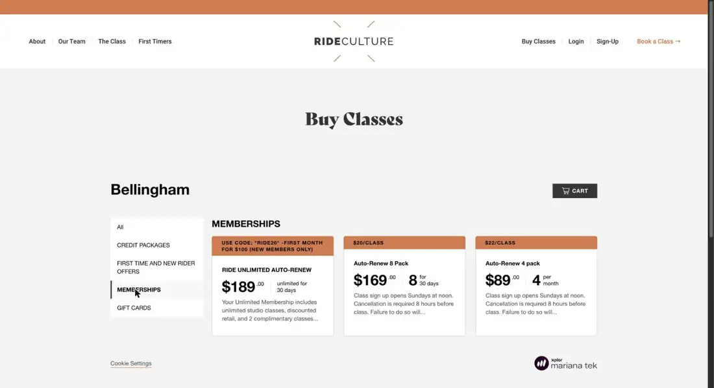

| | Intent | Ride Culture |
| --- | --- | --- |
| Single class | $25 | $32 |
| Packs | 5 for $105, 10 for $170, 20 for $300 | 5 for $145, 10 for $280 |
| Monthly | $119 autopay, 3-month minimum, guest pass, 15% off retail. $150 without autopay | $189 unlimited, 8 for $169, 4 for $89 |
| Annual | $1,300 | Not seen |
| New customers | $30 for 2 weeks unlimited | New rider offers and a promo code |

## Account

Four tabs: Reservations, Memberships and Credits, Purchases, and Personal Information.

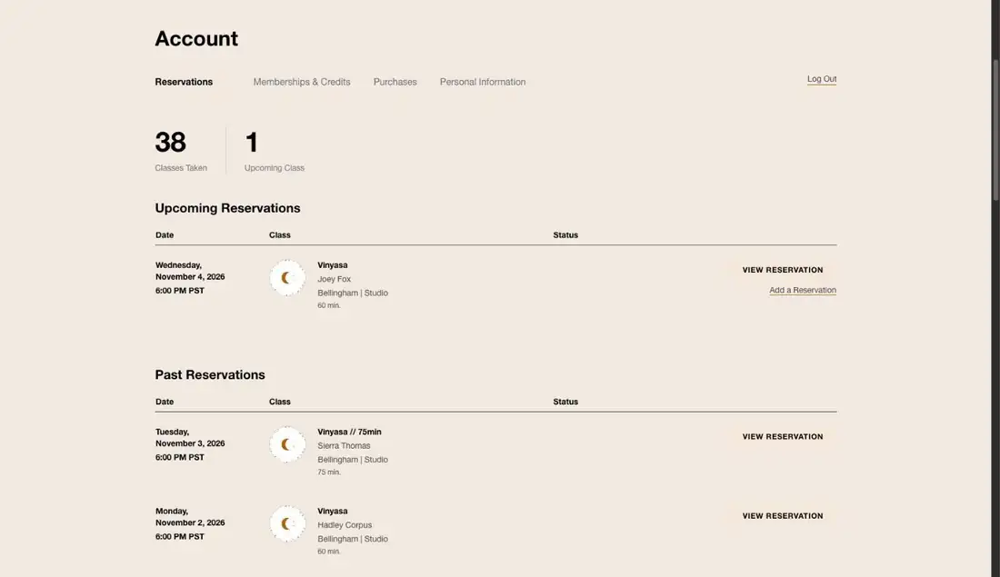

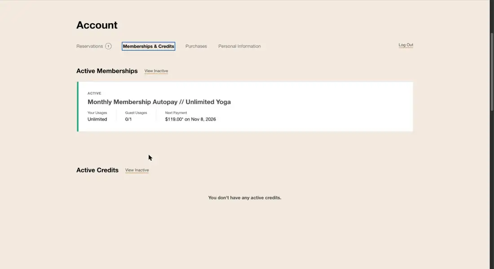

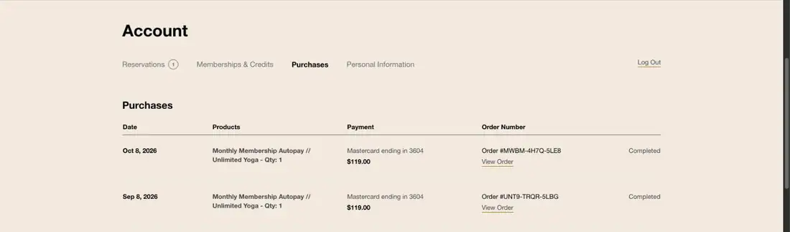

Settings hold a profile photo that helps staff recognize customers, an emergency contact, email and
text preferences, and saved cards.

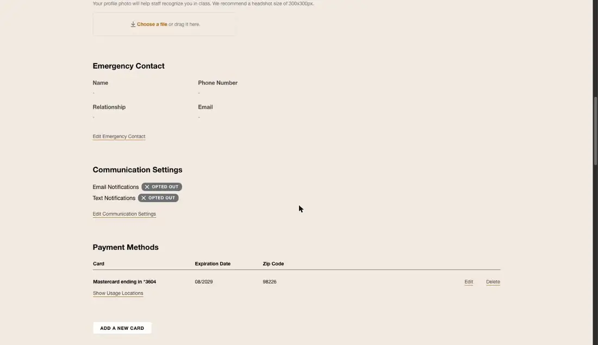

Past classes keep their outcome.

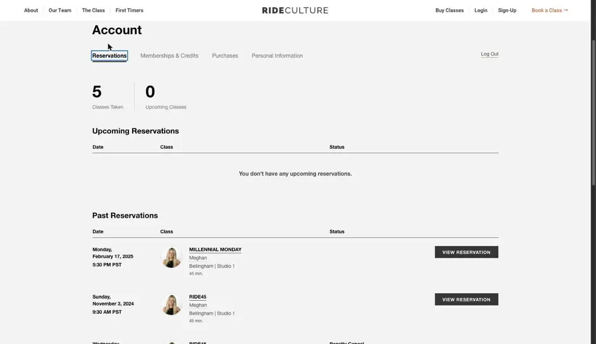

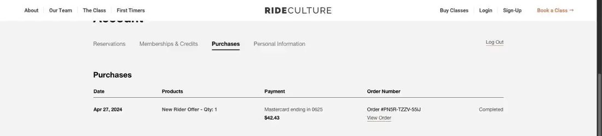

## Waiver

Intent's waiver collects name, contact details, birthday, and emergency contact. It is not part
of the booking flow: its signing terms name Xplor's BrandBot subscription terms, which suggests a
separate product from the same owner. Mariana Tek's own waiver handling was not seen. Minors need
a guardian's signature in the studio at both.

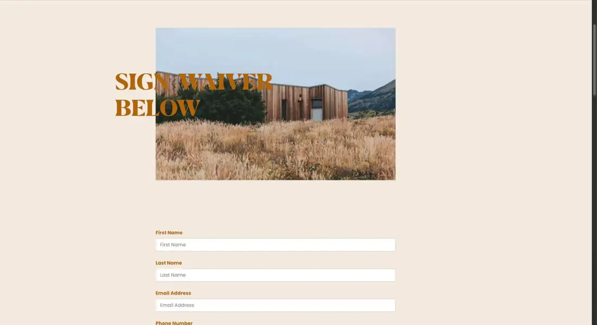

## Adding evidence

Put images in the folder for their flow, named `<studio>-<screen>.webp`, at most 1100 pixels wide and
WebP quality near 60. The 17 images here total about 235 KB. Leave out personal information pages and
anyone else's account, and look at each final image.
